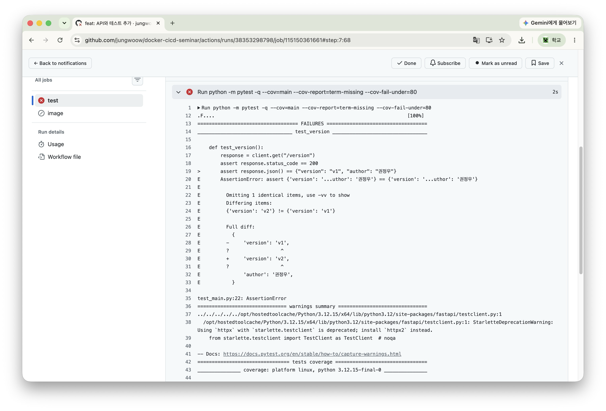
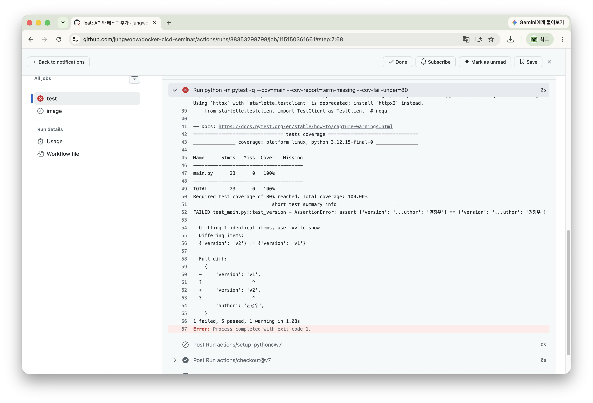
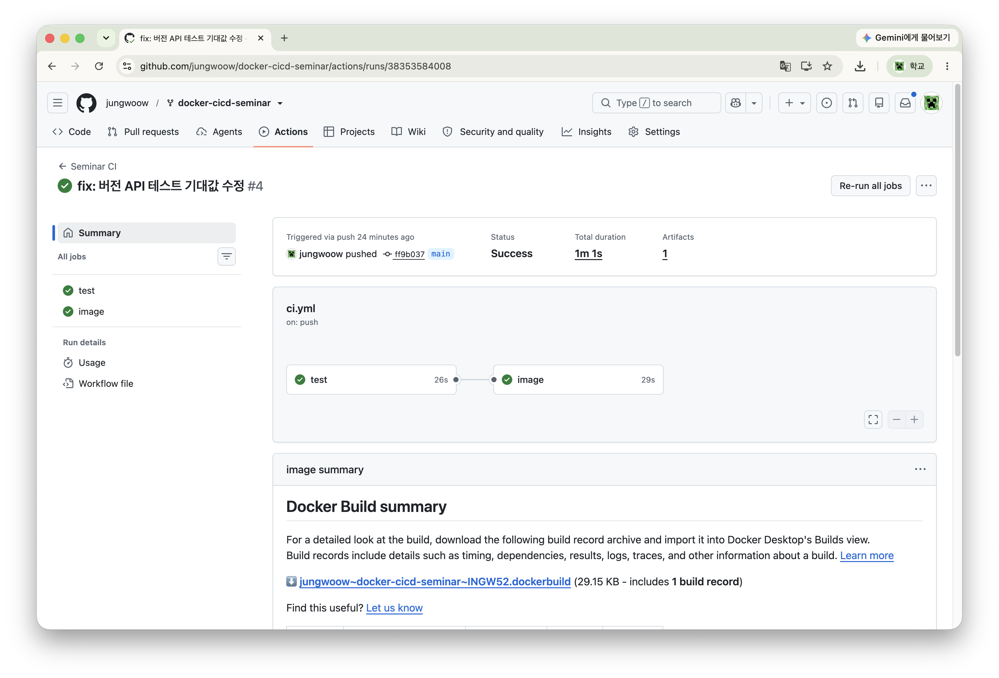
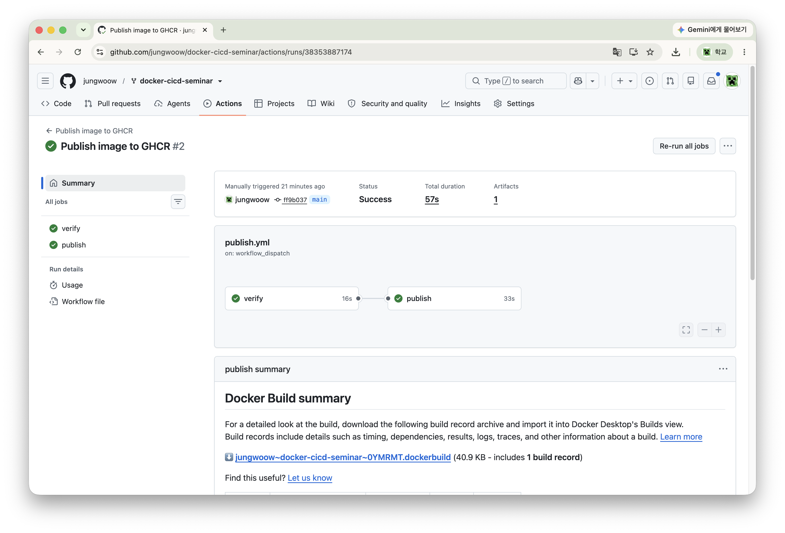
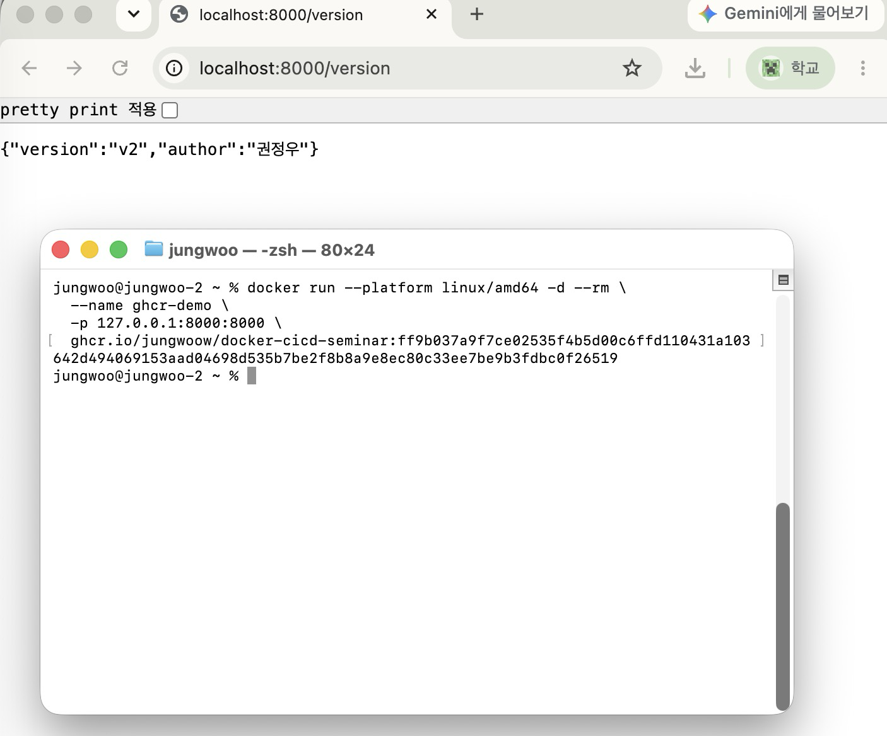

## ✨ 과제 내용

### GET /version API와 테스트 추가

현재 실행 중인 API의 버전과 작성자를 확인할 수 있도록 `GET /version` API를 추가했습니다.

```python
@app.get("/version")
def version():
    return {"version": "v2", "author": "권정우"}
```

`/version`으로 요청하면 아래와 같은 응답을 반환합니다 ~ ~

```json
{
  "version": "v2",
  "author": "권정우"
}
```

응답 상태 코드와 JSON 응답이 예상대로 나오는지 확인하는 테스트도 추가했습니다.

```python
def test_version():
    response = client.get("/version")
    assert response.status_code == 200
    assert response.json() == {"version": "v2", "author": "권정우"}
```

### CI 실패 → 수정 → 성공 확인

GitHub Actions에서 테스트 실패를 감지하는지 확인하기 위해, 처음에는 테스트의 버전 기대값을 일부러 `v1`로 작성했습니다.

```python
assert response.json() == {"version": "v1", "author": "권정우"}
```

실제 API는 `v2`를 반환하므로 테스트가 실패했습니다. 해당 변경을 push한 뒤 GitHub Actions에서도 테스트 단계가 실패하고, 이후 이미지 빌드 작업은 건너뛰어지는 것을 확인했습니다 !!

그 다음 기대값을 실제 응답과 같은 `v2`로 수정하고 다시 push했습니다.

```python
assert response.json() == {"version": "v2", "author": "권정우"}
```

수정 후에는 CI의 테스트와 Docker 이미지 빌드가 모두 성공했습니다. ㅎㅎ

- [CI 실패 기록 — feat: API와 테스트 추가](https://github.com/jungwoow/docker-cicd-seminar/actions/runs/38353298798)
- [CI 성공 기록 — fix: 버전 API 테스트 기대값 수정](https://github.com/jungwoow/docker-cicd-seminar/actions/runs/38353584008)

### 새 이미지 게시 및 실행

GitHub Actions의 **Publish image to GHCR** workflow를 수동 실행하여 수정된 코드의 Docker 이미지를 GHCR에 게시했습니다.

이미지 태그에는 해당 코드의 커밋 SHA를 사용했습니다

```text
ghcr.io/jungwoow/docker-cicd-seminar:ff9b037a9f7ce02535f4b5d00c6ffd110431a103
```

- [GHCR 이미지 게시 성공 기록](https://github.com/jungwoow/docker-cicd-seminar/actions/runs/38353887174)

게시된 이미지를 내려받고 컨테이너로 실행했습니다.

```bash
docker pull --platform linux/amd64 \
  ghcr.io/jungwoow/docker-cicd-seminar:ff9b037a9f7ce02535f4b5d00c6ffd110431a103
```

```bash
docker run --platform linux/amd64 -d --rm \
  --name ghcr-demo \
  -p 127.0.0.1:8000:8000 \
  ghcr.io/jungwoow/docker-cicd-seminar:ff9b037a9f7ce02535f4b5d00c6ffd110431a103
```

브라우저와 아래 명령으로 `/version` 응답을 확인했습니다.

```bash
curl http://localhost:8000/version
```

```json
{ "version": "v2", "author": "권정우" }
```

GHCR에서 내려받은 새 이미지에서도 추가한 API가 정상적으로 동작하는 것을 확인했습니다 ~ ~

## 📷 스크린샷 (선택)

<!-- 아래 항목의 스크린샷을 첨부해주세요. -->

- CI 실패 화면
  
  

- 수정 후 CI 성공 화면
  

- GHCR 이미지 수동 게시 및 성공 화면
  

- 컨테이너 실행 후 `/version` 응답 화면
  

## 📚 레퍼런스 (또는 새로 알게 된 내용) 혹은 궁금한 사항들

### 새로 알게 된 내용

#### CI에서 실패한 테스트가 이후 작업에 미치는 영향

이번 CI 설정에서는 이미지 빌드 작업에 `needs: test`가 설정되어 있습니다.

```yaml
image:
  needs: test
```

따라서 테스트 작업이 성공해야 이미지 빌드를 진행할 수 있습니다. 기대값을 일부러 틀리게 작성했을 때 테스트가 실패하면서 이미지 빌드도 건너뛰어졌습니다.

이를 통해 문제가 있는 코드를 다음 단계로 넘기지 않도록 자동으로 검증할 수 있다는 것을 확인했습니다 !!

#### 테스트 커버리지

커버리지는 테스트를 실행하면서 코드가 얼마나 실행됐는지 나타내는 지표입니다.

```bash
--cov=main --cov-report=term-missing --cov-fail-under=80
```

위 옵션으로 `main.py`의 커버리지와 실행되지 않은 코드를 확인하고, 커버리지가 80% 미만이면 실패하도록 설정할 수 있습니다.

#### Docker 포트 연결

컨테이너 실행 시 아래와 같이 포트를 설정했습니다.

```bash
-p 127.0.0.1:8000:8000
```

앞쪽 `8000`은 내 컴퓨터에서 접속하는 포트이고, 뒤쪽 `8000`은 컨테이너 안에서 FastAPI가 실행되는 포트입니다.

따라서 `http://localhost:8000/version`으로 요청하면 컨테이너 내부의 FastAPI로 전달됩니다. `127.0.0.1`을 지정하여 내 컴퓨터에서만 접속할 수 있도록 실행했습니다.
